 

  

<h1 align="center">Hi, I'm Shamraj Deb Nath 👋</h1>

  Computer Science and Engineering Student | Technical Project Builder
   
  Premier University · Chattogram, Bangladesh

  <a href="https://github.com/Shamraj-Deb-Nath">GitHub</a> ·
  <a href="https://www.linkedin.com/in/shamraj-deb-nath-b46920375/">LinkedIn</a>

---

## 👨‍💻 About Me

I am a Computer Science and Engineering student interested in technology, software development, and practical problem-solving.

I enjoy learning new technologies and building projects in different areas of Computer Science.

- 🎓 Studying Computer Science and Engineering at Premier University.
- 🤖 Interested in Machine Learning and Artificial Intelligence.
- 💻 Exploring Web and Android Application Development.
- 📊 Learning Big Data, Hadoop, and Data Engineering.
- ☁️ Exploring Cloud Computing and Software Engineering.
- ⚙️ Interested in Automation and AI-powered tools.

## 🚀 Featured Projects

Here are some projects from different areas of my technical journey.

### 🤖 Machine Learning & Artificial Intelligence

**[DNA Sequence Classification](https://github.com/Shamraj-Deb-Nath/DNA-Sequence-Classification)**

Machine Learning-based DNA sequence classification using k-mer features.

Technologies: Python, Naive Bayes, Logistic Regression, Random Forest, Bioinformatics.

### 📊 Big Data & Data Engineering

**[Medical Claims Analytics Hadoop](https://github.com/Shamraj-Deb-Nath/medical-claims-analytics-hadoop)**

A Java and Hadoop-based project focused on medical claims analytics.

Technologies: Java, Hadoop, Big Data.

### 🌐 Web Development

**[Exam Routine](https://github.com/Shamraj-Deb-Nath/Exam-Routine)**

A web project related to exam routine management.

Technologies: HTML.

**[Shamraj Website Mini](https://github.com/Shamraj-Deb-Nath/Shamraj-Websitemini)**

A personal web development project.

Technologies: HTML.

### 📱 Android Development

**[Android App](https://github.com/Shamraj-Deb-Nath/Android-App)**

An Android application development project.

### ☁️ Cloud & Microservices

**[Microservices Demo](https://github.com/Shamraj-Deb-Nath/microservices-demo)**

A cloud-first sample application demonstrating microservices architecture.

Technologies: Go, Kubernetes, Istio, gRPC.

---

## 🛠️ Technical Skills

**Programming Languages**

Python · Java · C · C++ · JavaScript · Kotlin

**AI & Data Technologies**

Machine Learning · Deep Learning · NLP · Bioinformatics · Big Data

**Development**

HTML · Flutter · Android Development · Web Development

**Tools & Platforms**

Git · GitHub · Hadoop · n8n · Cloud Technologies

## 📂 More Projects

I also work on academic assignments, practice applications, and experimental projects.

Explore all my repositories:

**[View All GitHub Repositories →](https://github.com/Shamraj-Deb-Nath?tab=repositories)**

## 🤝 Connect With Me

  
  

---

  <i>"Learning, Building, and Improving — One Project at a Time."</i>

